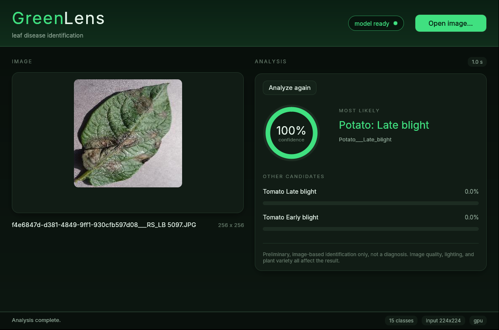
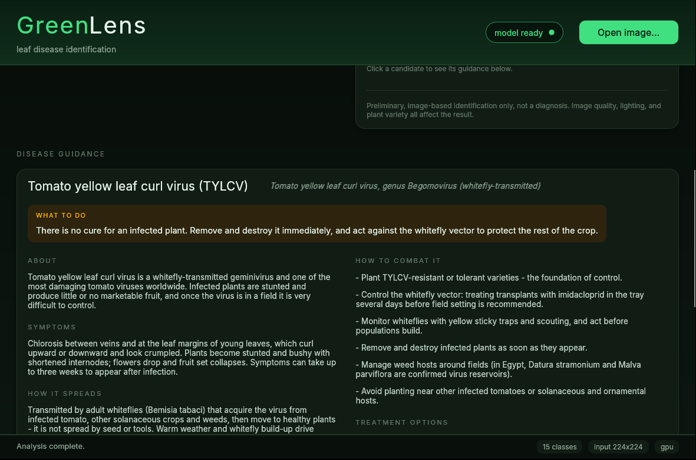

# GreenLens

GreenLens is a native desktop application that identifies plant diseases from
leaf images. A convolutional classifier built from a VGG16 backbone (TensorFlow
/ Keras, ImageNet transfer learning) runs in a local Python inference process;
a Rust desktop front end built with egui opens an image, sends it to the
worker, and displays the ranked class predictions with their probabilities.



## How it works

- The window is a native egui/eframe application (OpenGL), there is no browser
  and no web server involved.
- The model lives in a separate long-lived Python process that speaks a small
  JSON-lines protocol over stdin/stdout. Loading the model and running
  inference never block the UI thread, and a crashed or misbehaving worker is
  reported in the window instead of taking the app down.
- Results are shown as a confidence gauge plus ranked candidates, together
  with the inference time and the live worker state (loading, ready, failed).
- Every prediction carries disease guidance looked up in a committed SQLite
  database: what the disease is, how to recognize and fight it, notes for
  Egypt, and the sources the advice comes from.
- An image can be picked with the "Open image" button or handed to the app
  directly on the command line: `greenlens path/to/leaf.jpg`.

## Model

- Backbone: VGG16 with ImageNet weights, `include_top=False`. On top sit a
  global average pooling layer and a small head (dense 256, dropout 0.3,
  L2 1e-4, softmax over the classes).
- Training is two-staged: first the head is trained with the whole backbone
  frozen (10 epochs, Adam 1e-3), then `block5` is unfrozen and fine-tuned at a
  low learning rate (6 epochs, Adam 1e-5). Batch size 32, balanced class
  weights, `mixed_float16`, and light augmentation (horizontal flip, small
  rotation and zoom) during training only.
- Data: 15 crop disease classes from the PlantVillage dataset, 20,624 images
  after dropping exact duplicates. A stratified 70/15/15 split (seed 42) is
  recorded in `data/processed/manifest.json`.
- Held-out test split (3,095 images): **95.5% accuracy, macro F1 0.95**.
  Per-class precision/recall and the confusion matrix are in
  `artifacts/test_report.json` and `artifacts/confusion_matrix.png`.
- Caveat: PlantVillage is lab-style single-leaf photography and contains
  visually near-duplicate photos beyond the exact copies we drop, so the score
  describes controlled images, not real field conditions. Expanding training
  data with more diverse images (field photos, varied lighting and backgrounds)
  is future work.

Classes, grouped by crop: Pepper bell (bacterial spot, healthy); Potato (early
blight, late blight, healthy); Tomato (bacterial spot, early blight, late
blight, leaf mold, Septoria leaf spot, spider mites, target spot, yellow leaf
curl virus, mosaic virus, healthy).

### Artifacts

The trained model is committed so the app runs without retraining:

- `model.keras` - the best checkpoint, repacked without the optimizer state
- `class_names.json` - the class order behind the softmax output
- `metadata.json` - training configuration, dataset split sizes, environment
- `test_report.json`, `confusion_matrix.png` - evaluation on the held-out split
- `train_log_phase1.csv`, `train_log_phase2.csv` - per-epoch history
- `diseases.db` - disease guidance and cited sources, keyed by class id

## Disease guidance

After every analysis the app shows a guidance panel for the top prediction:
what the disease is, its symptoms and how it spreads, how to combat it
(cultural steps first, then treatment options), notes for Egyptian growers,
and the sources the advice was taken from, as clickable links. The other
candidates in the list are clickable too, so their guidance can be inspected
as well.



The guidance lives in a SQLite database, `artifacts/diseases.db`, keyed by the
same class ids the model predicts (the worker attaches the matching row to
each prediction). It is rebuilt from `ml/disease_info.json` with:

```sh
.venv/bin/python ml/build_diseases_db.py
```

Sources are limited to credible institutions: NC State Extension and its Plant
Disease and Insect Clinic, other US university extension services (NDSU,
UF/IFAS, UConn), and Egyptian research: the Agricultural Research Center
(Giza), Assiut University, Al-Azhar University, Cairo University and Egyptian
journals. Active ingredients are examples taken from those sources and must be
applied according to the locally registered product label - some products used
abroad are not registered in Egypt, and vice versa.

The schema is three tables: `diseases` (one row per class), `steps` (ordered
management and treatment instructions) and `sources` (ordered citations per
disease).

## Building and running

The app is an ordinary Rust project; build the release binary and run it:

```sh
cargo build --release
./target/release/greenlens            # pick an image in the window
./target/release/greenlens leaf.jpg   # or open one right away
```

The binary expects the virtualenv at `.venv/bin/python` (`Scripts\python.exe`
on Windows) and the `ml/` and `artifacts/` directories in the working
directory (the checkout doubles as the install location). `GREENLENS_HOME`
points it at a different directory and `GREENLENS_PYTHON` overrides the
interpreter. The "Open image" button uses the native file dialog; the command
line argument works everywhere. For Nix users, the included flake provides the
Rust toolchain, the GUI system libraries, and a Python 3.12 environment in dev
shells (`nix develop .`); it is not needed on other systems.

### Linux

Build prerequisites:

- a recent stable Rust toolchain
- Debian/Ubuntu: `libxkbcommon-dev libwayland-dev libx11-dev libxcursor-dev libxi-dev libxrandr-dev libgl1-mesa-dev`
- Fedora: `libxkbcommon-devel wayland-devel libX11-devel libXcursor-devel libXi-devel libXrandr-devel mesa-libGL-devel`
- Arch: `libxkbcommon wayland libx11 libxcursor libxi libxrandr mesa`
- an OpenGL 3.3 capable driver at runtime

The inference worker needs Python 3.12 with the packages from
`ml/requirements.txt`:

```sh
python3.12 -m venv .venv
.venv/bin/pip install -r ml/requirements.txt
```

On Linux the `tensorflow[and-cuda]` extra also pulls the CUDA runtime wheels;
GPU inference additionally needs a recent NVIDIA driver, otherwise TensorFlow
falls back to the CPU by itself. On macOS install plain `tensorflow` without
the extra.

### Windows

A recent stable Rust toolchain is all that is needed to build (the usual
MSVC setup from rustup); the worker uses the Windows virtualenv layout:

```powershell
cargo build --release
py -3.12 -m venv .venv
.venv\Scripts\pip install -r ml\requirements.txt
.\target\release\greenlens.exe leaf.jpg
```

The pip build of TensorFlow has been CPU only on native Windows since
TensorFlow 2.11, so the app works there but classifies without the GPU. For
GPU inference use WSL2: run `wsl --install` from an elevated PowerShell
prompt, do the Linux steps inside the distro (the regular Windows NVIDIA
driver already exposes CUDA to WSL2, do not install a driver inside the
distro), and WSLg shows the window like any other app. TensorFlow's pip
installation guide has the details:
[tensorflow.google.cn/install/pip](https://tensorflow.google.cn/install/pip)

## Reproducing the model

The PlantVillage images are not part of the repository; download the dataset
and point the preparation script at the folder that contains the class
directories:

```sh
python3.12 -m venv .venv
.venv/bin/pip install -r ml/requirements.txt
.venv/bin/python ml/prepare_data.py --raw data/raw/plantvillage/PlantVillage --out data/processed
.venv/bin/python ml/train.py --manifest data/processed/manifest.json --artifacts artifacts
```

Training uses the GPU when one is available and falls back to the CPU. The
first run downloads the ImageNet weights for VGG16 into the Keras cache.

### Training in Docker

A headless image provides the same environment (python 3.12 and the pinned
packages) if you prefer not to install them on the host. Build it with the
`ml/` directory as the context and mount `data/` and `artifacts/` into it:

```sh
docker build -t greenlens-ml ml/
docker run --rm -v "$PWD/data:/work/data" greenlens-ml \
    python ml/prepare_data.py --raw data/raw/plantvillage/PlantVillage --out data/processed
docker run --rm -v "$PWD/data:/work/data" -v "$PWD/artifacts:/work/artifacts" greenlens-ml \
    python ml/train.py --manifest data/processed/manifest.json --artifacts artifacts
```

Add `--gpus all` to the training run for GPU use (the host needs
`nvidia-container-toolkit`); without it the container trains on the CPU.

## Tests

```sh
cargo test
.venv/bin/python -m pytest ml/tests
```

The Rust side covers protocol parsing plus integration tests that drive the
real worker and model (they skip when `artifacts/model.keras` is missing). The
Python side covers the image pipeline, duplicate detection, manifest splitting
and the worker protocol.

## Layout

- `src/` - the desktop app (`app.rs`), the worker subprocess bridge
  (`worker.rs`) and the entry point (`main.rs`)
- `ml/` - dataset preparation, shared preprocessing, training, the inference
  worker, the disease-guidance database builder and their tests
- `artifacts/` - trained model, evaluation reports and the guidance database
- `data/` - raw and processed datasets (not committed)
- `assets/` - bundled fonts and the README screenshots
